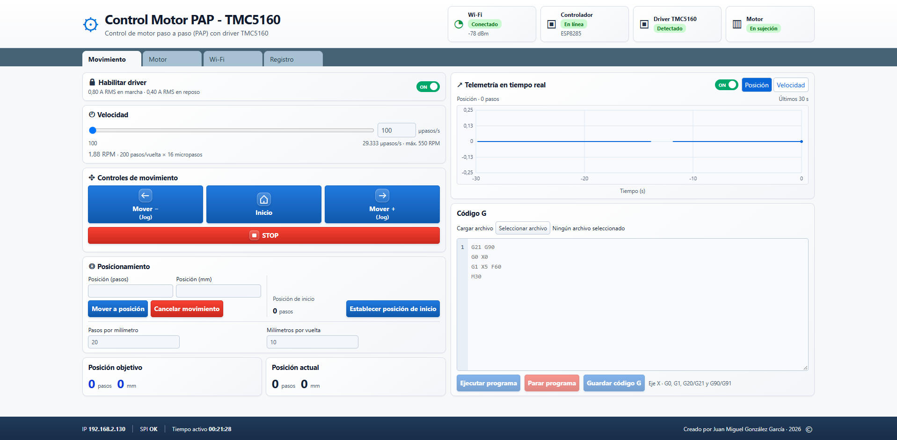

# MotorPAP · ESP8285 y TMC5160

Firmware para controlar un motor paso a paso desde un navegador en la red local. El ESP8285 configura y consulta el TMC5160 por SPI y genera los pulsos `STEP` con el temporizador Timer1. El panel web permite mover el motor en ambos sentidos, ajustar la velocidad durante el movimiento y consultar el estado del driver.



## Conexiones

> [!WARNING]
> **Muy importante: máxima precaución si montas el circuito en una protoboard.** Las corrientes elevadas del motor pueden sobrecalentar los contactos y los puentes de la protoboard, derretir el plástico y dañar el montaje. Para motores de alto consumo, lleva la alimentación de potencia al driver y conecta el motor directamente a sus salidas con cables y bornes dimensionados para la corriente. Reserva la protoboard para las señales de control y las conexiones de baja corriente.

Los nombres `D0` a `D8` corresponden al entorno `d1_mini_pro` de PlatformIO. Si tu placa usa números GPIO, sigue la columna central.

| Pin | GPIO | Señal del TMC5160 |
| --- | --- | --- |
| D0 | 16 | `STEP`, pulsos de movimiento |
| D1 | 5 | `CS`, selección SPI activa en bajo |
| D2 | 4 | `EN`, habilitación activa en bajo |
| D5 | 14 | `SCK`, reloj SPI |
| D6 | 12 | `MISO`, datos del driver al ESP |
| D7 | 13 | `MOSI`, datos del ESP al driver |
| D8 | 15 | `DIR`, sentido de giro |
| GND | — | Masa común |

Configura el módulo TMC5160 para aceptar señales externas `STEP/DIR` y habilitar la comunicación SPI. El firmware usa SPI en modo 3 a 500 kHz. Alimenta el motor a través del driver según las especificaciones del módulo y del motor. El cálculo de corriente del firmware presupone resistencias de sensado de **0,075 Ω** por fase. Comprueba ese valor en tu módulo antes de habilitarlo.

En **Motor → Polaridad de los pines** puedes elegir **Normal** o **Invertido** para **DIR (D8)**, **EN (D2)** y **CLK/STEP (D0)** con el driver en **OFF**. DIR invierte el sentido físico y CLK/STEP cambia el nivel de reposo y la polaridad de los pulsos. Cambiar DIR o CLK/STEP reinicia el contador y la posición de inicio.

Con cableado directo al TMC5160, deja **EN en Normal**. El pin `DRV_ENN` del driver es activo en bajo. Usa **EN invertido** si el circuito intermedio invierte la señal y mantiene el driver deshabilitado al arrancar. El firmware desactiva la etapa de potencia por SPI antes de probar la nueva polaridad de EN y comprueba que `DRV_ENN` quede alto. Las tres polaridades vuelven a **Normal** al reiniciar el ESP.

## Compilar y cargar

El proyecto usa PlatformIO con el framework Arduino para ESP8266. El entorno `d1_mini_pro` usa el script `eagle.flash.1m128.ld` para una flash de 1 MB con espacio reservado para el sistema de archivos. `platformio.ini` configura `COM7` para la carga y el monitor serie, ambos a 115200 baudios. Ajusta los puertos si tu adaptador aparece con otro nombre.

Desde la raíz del proyecto, con PlatformIO Core disponible en la terminal:

```sh
pio run -e d1_mini_pro
pio run -e d1_mini_pro -t upload
pio device monitor -e d1_mini_pro
```

## Conectar al Wi-Fi y abrir el panel

1. Abre el monitor serie a **115200 baudios**, con envío de fin de línea, y reinicia la placa.
2. Si todavía necesita configurar una red, el ESP8285 lista las redes de **2,4 GHz** que detecta. Envía el número de la red y pulsa Enter. Para una red protegida, introduce la clave cuando se solicite.
3. Cuando se conecta, el firmware muestra una dirección como `http://192.168.1.42/`. Ábrela desde un dispositivo en la misma red.
4. Para volver a buscar redes, envía `R` por el monitor serie cuando no estés introduciendo una clave. Al abrir el menú, el firmware deshabilita el driver.

Las credenciales se guardan en LittleFS después de establecer la conexión y se reutilizan al arrancar. Si la conexión o la reconexión falla durante 25 segundos, vuelve a aparecer el menú de redes.

En la pestaña **Wi-Fi** puedes ver el modo activo y cambiarlo con el driver en **OFF**.

- **Conectar a una red**. Pulsa **Buscar redes Wi-Fi** y marca una red de 2,4 GHz en el listado de diez por página. Introduce su contraseña si es protegida. Para una red que no aparezca, usa **Introducir SSID**. Una vez conectada, abre el panel con la IP que indica el monitor serie.
- **Punto de acceso**. Escribe el nombre de la red propia del ESP y una contraseña de 8 a 63 bytes. Pulsa **Activar punto de acceso**, conecta el PC o móvil a esa red y abre la dirección indicada por el panel. Puedes volver al modo **Conectar a una red** desde el mismo panel.

**Configuración IP** se guarda por separado para cada modo. Al conectar el ESP a una red, DHCP obtiene la dirección del router, y la opción manual permite introducir una dirección IP, una máscara de subred y una puerta de enlace. En modo punto de acceso, DHCP usa `192.168.4.1` para el ESP y asigna direcciones a los clientes. Con configuración manual, introduce los tres datos para el ESP y configura el cliente con una IP de la misma subred. Guarda la configuración IP antes de activar el otro modo, o guárdala en el modo activo para aplicarla a la conexión actual.

El panel se desconecta durante el cambio. El ESP conserva el modo y los datos de la nueva red para el siguiente arranque cuando la configuración funciona. Si el cambio falla, intenta recuperar la configuración anterior antes de mostrar el menú serie.

El panel muestra la dirección IP, el tiempo de actividad y la intensidad de señal en dBm. El navegador espera **500 ms** entre ciclos de consulta de estado y **150 ms** mientras ejecuta código G. El ESP mide la señal en la primera consulta y reutiliza la última lectura durante **10 segundos**. Si falla la consulta de estado, el indicador de señal muestra **Sin datos**.

## Mover el motor

La pestaña **Motor** reúne los ajustes del driver y las rampas. En **Movimiento** encontrarás el ajuste de velocidad, los controles de giro y parada, el posicionamiento, las lecturas de posición y la telemetría.

1. Con el driver en **OFF**, ajusta la corriente de marcha y pulsa **Aplicar** en **Corriente del motor**, justo debajo de **Habilitar driver**. En ese panel también se muestra la corriente de mantenimiento calculada. Selecciona los micropasos y, si quieres cambiar de **SpreadCycle** a **StealthChop2**, activa **Modo silencioso**.
2. Pon el driver en **ON**. El firmware comprueba por SPI que el TMC5160 responde, que está en modo `STEP/DIR` y que se puede habilitar. Con StealthChop2 activado, espera a que termine el ajuste inicial antes de mover el motor.
3. Ajusta la velocidad y los tiempos de aceleración y deceleración. Pulsa **Mover +** o **Mover −** para iniciar el giro continuo (jog) en el sentido positivo o negativo, respectivamente. Puedes cambiar de velocidad durante el giro. Si pulsas el botón del sentido opuesto, el firmware frena hasta detenerse y acelera en la dirección nueva.
4. Pulsa **STOP** para frenar con la rampa configurada y mantener el driver habilitado. Cambia a **OFF** para cortar los pulsos y deshabilitar la salida inmediatamente.

Durante un jog, el navegador envía una renovación (`keepalive`) en cada ciclo de consulta. Si el firmware pasa unos **3 segundos** sin recibir una renovación, corta los pulsos y deshabilita el driver. También deshabilita el driver al detectar que ha perdido la conexión Wi-Fi mientras el servidor está activo.

| Ajuste | Valores |
| --- | --- |
| Micropasos por paso | De 1 a 256 en potencias de dos. Valor inicial de 16. |
| Velocidad | Desde 100 micropasos/s. Límite de 550 RPM hasta 16 micropasos por paso y de 100 RPM con resoluciones superiores. |
| Aceleración y deceleración | Cada rampa admite de 0,10 a 600 s. Valor inicial de 0,20 s. |
| Corriente de marcha | De 0,10 a 1,20 A RMS en incrementos de 0,01 A. Valor inicial de 0,80 A RMS. |
| Corriente de mantenimiento | Calculada a partir del ajuste de marcha, con un límite de 0,40 A RMS. |

La conversión a RPM supone un motor de **200 pasos completos por vuelta**. A 16 micropasos, el límite de 550 RPM equivale a **29.333 micropasos/s**. Los ajustes del motor se restablecen al reiniciar el ESP y el driver arranca deshabilitado, con SpreadCycle seleccionado.

### Posicionamiento

Con el driver habilitado y el motor detenido, introduce una posición absoluta en pasos completos (de −1.000.000 a 1.000.000) o en milímetros y pulsa **Mover a posición**. El panel convierte los milímetros según la calibración y redondea el destino a pasos completos. El ESP elige el sentido según la diferencia con la posición actual, utiliza la velocidad y las rampas configuradas y termina al emitir el último micropaso. **Posición objetivo** muestra la última orden y **Posición actual** sigue los pulsos emitidos, también durante el giro manual. **STOP** y el plazo de seguridad de la conexión se aplican también a este movimiento.

Con el motor detenido, pulsa **Establecer posición de inicio** para guardar su posición actual con precisión de micropaso. **Inicio** vuelve a esa posición con la misma velocidad y rampas. La referencia y la posición de inicio empiezan en cero al arrancar y se reinician si cambias la resolución de micropasos. La posición se estima a partir de los pulsos del ESP, por lo que un paso perdido o un giro manual del eje con el driver deshabilitado no se refleja en el panel.

### Telemetría

La gráfica muestra los últimos 30 segundos de **Posición** en pasos completos o **Velocidad** en RPM con signo según el sentido. Usa las mismas consultas de estado que el resto del panel. La velocidad se calcula con la frecuencia de los pulsos STEP. El historial se conserva en el navegador mientras está abierto el panel y la línea se interrumpe si faltan muestras. Al poner el interruptor en **OFF**, se borra la gráfica y se dejan de registrar muestras. Los controles del motor siguen disponibles.

### Ejecutar código G

En **Movimiento → Posicionamiento**, introduce los **pasos completos por milímetro** o los **milímetros por vuelta** de tu montaje. El panel calcula el otro campo usando 200 pasos completos por vuelta. En **Código G**, abre un archivo o pega el programa. **Guardar código G** descarga el texto del editor. Con el driver habilitado y el motor detenido, pulsa **Ejecutar programa**. El panel valida el archivo y carga todos los movimientos en el ESP antes de arrancar. El editor muestra los números de línea y destaca la línea que comunica el ESP. Mantén la página abierta para que el panel renueve el permiso de movimiento.

El editor admite el eje **X**, `G0` y `G1`, `G90` (absoluto) y `G91` (incremental), `G21` (milímetros) y `G20` (pulgadas). Indica `G0` o `G1` antes del primer desplazamiento. El modo de movimiento se mantiene hasta que se indique otro. La velocidad configurada en **Movimiento** se aplica a `G0`. Para `G1`, `F` fija el avance en las unidades activas por minuto y se reutiliza hasta que se indique otro avance. Si el avance queda fuera del rango que permiten la calibración y los micropasos, el panel muestra ese rango y rechaza el programa antes de mover el motor.

El modo inicial es absoluto en milímetros, sobre el cero del contador. El modo incremental parte de la posición actual. Los destinos se redondean a pasos completos. El ESP enlaza los tramos consecutivos en el mismo sentido y aplica las rampas para adaptar el avance, invertir el sentido o terminar el programa.

El fin de programa es opcional. Si lo indicas, escribe `M2` o `M30` en una línea propia. Se admiten números de línea `N`, comentarios entre paréntesis o desde `;` hasta el fin de línea y líneas que solo contienen `%`. Puedes cargar archivos de hasta 64 KiB y ejecutar hasta 1.000 movimientos por programa.

```gcode
G21 G90
G1 X5 F60
G1 X0
M30
```

**Parar programa** y **STOP** cancelan el programa y solicitan la deceleración. Deshabilitar el driver o perder la conexión también cancela el programa. La ejecución no se reanuda automáticamente.

## Diagnóstico

- La pestaña **Registro** muestra los últimos 48 eventos desde el arranque, fechados con la hora local del PC o móvil que abre el panel. Incluye los cambios de red, las órdenes del motor, los diagnósticos del TMC5160 y la causa de deshabilitación cuando el firmware la detecta. Pulsa **Descargar TXT** para guardar en el PC el historial que ves en pantalla con las mismas marcas de tiempo. El registro se conserva en RAM hasta que se reinicia o apaga la placa.
- El firmware comprueba por SPI el estado del TMC5160 aproximadamente cada **segundo**. El panel muestra si responde, el estado de `EN`, el preaviso térmico o la sobretemperatura, los cortocircuitos y los fallos del driver. Los eventos de subtensión se consultan en **Registro**. La lectura de StallGuard está disponible a partir de 10 RPM, con el driver habilitado, en movimiento y fuera de StealthChop.
- El monitor serie informa de la identificación SPI y muestra el registro `IOIN`. Si el panel indica **Sin identificar**, revisa `CS`, el cableado SPI y la alimentación del módulo. Si el driver aparece detectado pero no se habilita, comprueba `EN` y el modo `STEP/DIR`.

## Organización del código

| Código | Cabecera | Función |
| --- | --- | --- |
| [`main.cpp`](src/main.cpp) | — | Inicialización y bucle principal. |
| [`Tmc5160.cpp`](src/Tmc5160.cpp) | [`Tmc5160.h`](include/Tmc5160.h) | Configuración SPI, diagnóstico, corriente y generación de pulsos y rampas. |
| [`GcodePlanner.cpp`](src/GcodePlanner.cpp) | [`GcodePlanner.h`](include/GcodePlanner.h) | Carga de movimientos, planificación de velocidades y seguimiento de la línea activa. |
| [`MotorWebServer.cpp`](src/MotorWebServer.cpp) | [`MotorWebServer.h`](include/MotorWebServer.h) | Servidor HTTP en el puerto 80 y rutas `/api/` para consultar y controlar el motor. |
| [`EventLog.cpp`](src/EventLog.cpp) | [`EventLog.h`](include/EventLog.h) | Historial circular en RAM y exportación de eventos a texto. |
| — | [`MotorPanel.h`](include/MotorPanel.h) | HTML, CSS y JavaScript del panel integrado en el firmware. |
| [`WifiMenu.cpp`](src/WifiMenu.cpp) | [`WifiMenu.h`](include/WifiMenu.h) | Escaneo y selección de redes desde el puerto serie. |
| [`WifiConnection.cpp`](src/WifiConnection.cpp) | [`WifiConnection.h`](include/WifiConnection.h) | Modos estación y punto de acceso, configuración IP, reconexión y recuperación de la configuración anterior. |
| [`WifiStorage.cpp`](src/WifiStorage.cpp) | [`WifiStorage.h`](include/WifiStorage.h) | Lectura y escritura de las credenciales y de la configuración IP en LittleFS. |

## 📜 Licencia y derechos de autor

**Copyright © 2026 Juan Miguel González García**

Este proyecto se distribuye gratuitamente para uso **personal, educativo, experimental y no comercial**.

### ✅ Usos permitidos

- Descargar y probar el software libremente.
- Utilizarlo en proyectos personales y domésticos.
- Estudiar su código fuente.
- Modificarlo para uso particular y no comercial.
- Experimentar con el hardware y desarrollar aplicaciones personales.

### ❌ Usos no permitidos

Sin autorización previa y por escrito del autor, queda prohibido:

- Vender el software original o versiones modificadas.
- Incorporarlo a productos o dispositivos comerciales.
- Utilizarlo en servicios comerciales remunerados.
- Explotar económicamente su código fuente o versiones derivadas.
- Redistribuir públicamente el código original o modificado, salvo los supuestos expresamente permitidos.

### 💼 Licencias comerciales

Para utilizar este proyecto en productos, servicios o actividades comerciales, es necesario solicitar una autorización específica.

**Autor:** Juan Miguel González García\
**Contacto:** [juammigg@gmail.com](mailto:juammigg@gmail.com)

### ⚖️ Condiciones legales

Este proyecto **no se distribuye bajo una licencia Open Source**. Su código fuente es público, pero su utilización está sujeta a condiciones.

Consulta [COPYRIGHT.md](COPYRIGHT.md) para conocer las condiciones completas.

El software se proporciona sin garantías, en la medida permitida por la legislación aplicable.

---

© 2026 Juan Miguel González García. Todos los derechos reservados, excepto los expresamente concedidos.
